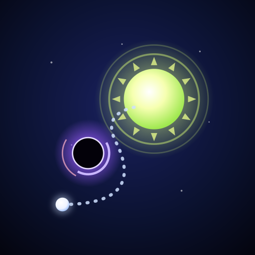

# Portal Shoot

A glowing physics puzzle for phones. Pull back, let go, and slingshot the ball into the sun portal with **exactly** the number of bounces it asks for.

**Play the beta:** https://portal-shoot.netlify.app (installable as an app, works offline)

<p align="center"></p>

## What's in the game

- **Endless worlds.** Short worlds first (5, 5 and 6 levels), then 8 levels per world. Every world adds one idea: boost pads, coral hazards, moving walls, black holes, spike orbs, gaps in the frame.
- **Dark Worlds.** Starting with World 4, you see the board for a few seconds, then the lights go out and you shoot from memory. Only the sun stays lit.
- **Lives per world.** 5 ♥ per world run. Clearing a level heals 1 ♥. Out of lives means you continue for stars, watch an ad once per world, or start the world over with a fresh kit.
- **Power-ups.** Perfect Path, Ice Freeze, Ghost Ball, Infinite Bounce, Gravity Pull and Searchlight (Dark Worlds only).
- **World prizes.** The first clear of a world gives a power-up that matches its theme. Clearing the first Dark World also unlocks the **Eclipse** ball trail.
- **Stars** are the in-game currency. They're paid only when you improve a level's rating, so they can't be farmed. There's also a daily bonus.

## Repository layout

```
web/                 ← the game. Deploy this folder as-is.
  index.html         single file: HTML + CSS + JS (no build step, no dependencies)
  manifest.webmanifest, sw.js, icons/   PWA: install + offline
design/              source SVGs for the app icons
docs/                game design, analytics events, launch plan
tests/smoke.mjs      Playwright smoke tests
tools/build-artifact.mjs   makes the single-file preview build (dist/portal-shoot.html)
```

### Inside `web/index.html`

The file is split into labelled sections, so you can find things with search:

| Section | What it holds |
|---|---|
| `<script id="core">` | Pure logic: world layout (`WORLD_SIZES`), difficulty (`params`), physics (`simulate`), level generator. Also used as the Web Worker that builds levels in the background. |
| `ENGINE` | Game state, shots, lives, power-ups, events (`Engine.on(...)`). |
| `RENDERER` | Canvas drawing: arena, sun portal, trails, Dark World mask, effects. |
| `PERSISTENCE` | `Store`: progress, wallet, inventory, cosmetics, save migration. |
| `ANALYTICS` | GA4 events through `track(name, params)`. |
| `MONETISATION` | `Ads` (rewarded video adapter), `Billing` (in-app purchase adapter), `PRODUCTS` catalog. |
| `UI` | Journey map, store, modals, the world transition and the splash screen. |

## Run it locally

```bash
npm run serve            # http://localhost:8080 (any static server works)
```

Useful URL flags:

| Flag | Effect |
|---|---|
| `?debug` | Logs every analytics event to the console |
| `?ads=test` | Shows the rewarded-ad buttons with a 3-second fake ad |
| `?iap=test` | Lets you "buy" store packs without paying (testing only) |

## Tests

```bash
npm install
npx playwright install chromium
npm test
```

The smoke test checks the 5/5/6/8 world layout, that World 4 is the first Dark World, that levels 1–40 all generate real solutions, that old saves migrate correctly, that the ad caps work, and that the page has no errors.

## Deploy

The beta is hosted on Netlify and **deploys automatically**: every push to `main` publishes the `web/` folder (see `netlify.toml`). No build step.

When you ship a new version, bump `VERSION` in `web/sw.js` so installed copies update.

> **Before the public launch:** remove `<meta name="robots" content="noindex, nofollow">` from `web/index.html`. It keeps the beta out of search engines.

## Monetisation

All ads are **opt-in rewarded videos**. There are no forced ads.

| Placement | Reward | Cap |
|---|---|---|
| Game over | +3 ♥ continue | once per world run |
| Level clear | double the stars just earned | once per level |
| Daily bonus | double it | once a day |
| Stuck (3+ misses) | Perfect Path hint | once per level (free on the web) |
| Store | free power-up | 3 a day |

The store sells a Starter Pack, star packs, two themed bundles, the Aurora trail and an **Ad-free Pass**. The pass grants every ad reward instantly, without a video.

On the web there are no ads or purchases. The Android app (Capacitor + AdMob + Google Play Billing) will plug in through two globals:

```js
window.PortalAds     = { show(placement) → Promise<boolean> }
window.PortalBilling = { products() → Promise<[{id, price}]>, buy(id) → Promise<boolean> }
window.PortalGrant(id)   // the app calls this to restore non-consumable purchases
```

See [docs/launch-plan.md](docs/launch-plan.md) for the Google Play roadmap.

## Analytics

GA4 is configured with `GA_ID` in `web/index.html`. The game respects Do Not Track and sends only game events and level numbers. The event list is in [docs/analytics.md](docs/analytics.md).

## Status

Version **0.10.0** (beta). See [CHANGELOG.md](CHANGELOG.md).
